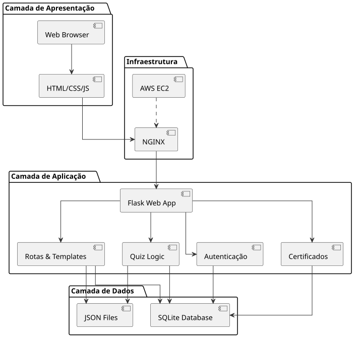
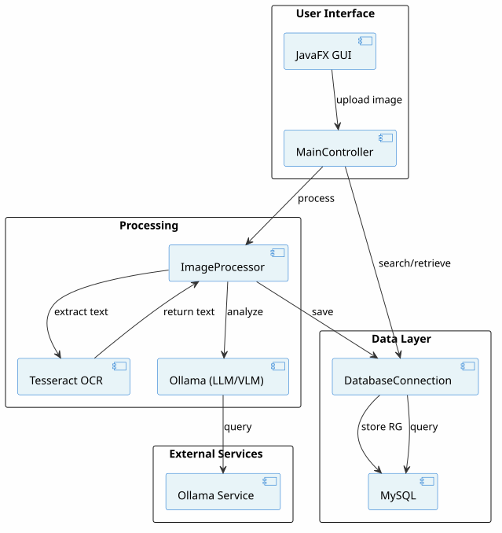
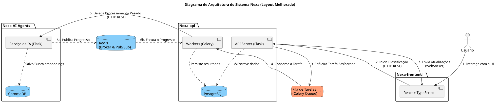
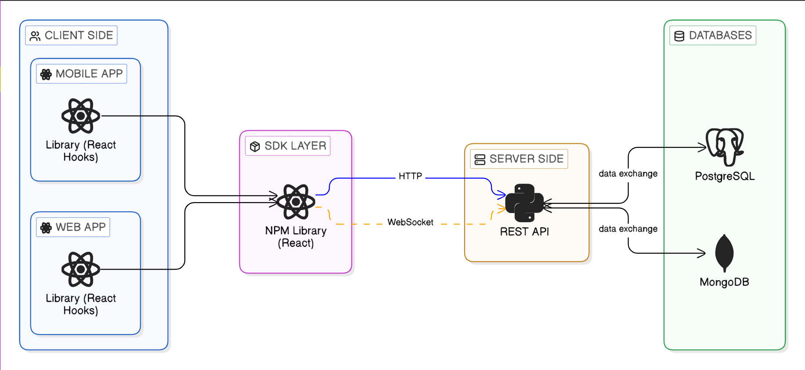
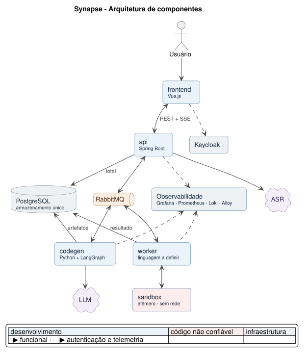

# Portfólio - Pedro Felipe Sousa Garcia

## Apresentação

Nome: **Pedro Felipe Sousa Garcia** | Idade: **29 anos**

### 🎓 Curso
**Tecnologia em Análise e Desenvolvimento de Sistemas**, Faculdade de Tecnologia de São José dos Campos (Fatec Prof. Jessen Vidal).

### Histórico acadêmico
- 2017 a 2021: graduação em **Publicidade e Propaganda na ECA-USP**.

- 2024 até hoje: graduação em andamento em **Análise e Desenvolvimento de Sistemas na Fatec-SJC**.

### Motivação para entrar na Fatec

Há uma curiosa inclinação humana para persistir precisamente naquilo que já não promete futuro algum. A justificativa costuma vir revestida de prudência: “já investi tempo demais para abandonar agora”. É o que chamam de Falácia dos Custos Irrecuperáveis, expressão técnica para um mecanismo bastante antigo da vaidade. O tempo já gasto adquire certa autoridade moral sobre o espírito, e por isso continuamos, menos por convicção do presente que pelo constrangimento de um erro passado.

Minha saída da área de publicidade começou com uma suspeita dessa natureza, a de que a permanência já não era prudência, mas inércia adornada de hábito. Não houve ruptura dramática nem súbita iluminação vocacional. Houve apenas um acúmulo progressivo de incompatibilidades silenciosas, dessas que a consciência percebe antes que a coragem as aceite.

Durante algum tempo, conservei a conhecida esperança de reconciliar desconforto e estabilidade, solução muito apreciada pelo espírito humano, embora raramente eficaz. Aos poucos, porém, a decisão de mudar de área foi adquirindo contornos inevitáveis. Por isso reduzi trabalhos, reorganizei prioridades e iniciei uma transição gradual, até que a antiga profissão se tornasse menos um destino e mais uma memória administrativa.

A área de tecnologia apresentou-me uma combinação singular de rigor lógico e liberdade criativa. Há nela certa poesia austera, feita de sistemas complexos construídos sobre regras inflexíveis, de abstrações inteiras sustentadas por estruturas invisíveis e de problemas que, embora frequentemente irritantes, conservam ao menos a honestidade de admitir solução.

Descobri então uma afeição particular por esses problemas, que chamo, por delicadeza literária, de quebra-cabeças. Todo desenvolvedor convive com eles, pequenos labirintos de lógica, arquitetura e ambiguidades humanas traduzidas em linguagem formal. Diferentemente de muitas perplexidades da vida comum, os quebra-cabeças da programação ao menos permitem depuração.

A decisão de ingressar na Fatec Prof. Jessen Vidal para cursar Análise e Desenvolvimento de Sistemas surgiu como consequência natural desse movimento. A reputação da instituição, somada à qualidade reconhecida do curso, ofereceu não apenas formação técnica, mas também o ambiente adequado para transformar uma mudança de direção em projeto concreto.

Hoje percebo que certas escolhas profissionais não nascem exatamente de paixão, como afirmam os discursos otimistas, mas de reconhecimento. Há momentos em que alguém encontra um tipo de problema compatível com a própria maneira de pensar, e creio ter sido esse o meu caso.

### 💼 Histórico Profissional

#### Atuação na área de tecnologia (após o ingresso na Fatec)

##### RCDNC, Estagiário em Desenvolvimento de Sistemas
*Novembro de 2025 até hoje*

Software house que desenvolve projetos para o setor público e a área fiscal. Stack predominante: Node.js (Next.js e NestJS), PostgreSQL, Redis, Docker e GitHub Actions.

**Projeto VigieEditais (gerenciamento de licitações públicas):**

- Detectei e corrigi bugs em produção, com foco em gargalos de desempenho e em aderência às regras de negócio.
- Traduzi especificações de editais públicos em regras de negócio e requisitos de software.
- Implementei processamento assíncrono com filas e Redis para reduzir o acoplamento entre componentes.
- Automatizei integrações com serviços externos e fluxos de negócio que antes dependiam de etapas manuais.
- Conduzi testes manuais e reportei bugs críticos no GitHub Issues, com evidências e passos de reprodução, durante uma entrega emergencial.
- Validei correções após cada deploy contra critérios de aceitação definidos previamente.

**Projeto CriptoDeclara (análise e arquitetura de sistema fiscal), de abril de 2026 até hoje:**

- Interpretei requisitos fiscais e arquiteturais e desmembrei documentos técnicos (RFCs) em épicos e sub-issues acionáveis, com critérios de aceitação (DoD) explícitos.
- Especifiquei a refatoração para uma arquitetura orientada a eventos com NestJS, que eliminou *race conditions* e garantiu a conciliação atômica dos dados.
- Identifiquei falhas estruturais (silos de dados e *weak linking*) e modelei um motor de normalização e sanitização de entradas para preservar a integridade da fonte única de verdade do banco.
- Defini cenários de validação e critérios de testabilidade ainda na fase de especificação.
- Corrigi o uso incorreto de `float` para valores monetários no backend e adotei `decimal.js` para evitar erros de arredondamento em cálculos fiscais.

#### Atuação anterior ao ingresso na Fatec

##### IBGE, Agente Censitário Supervisor
*Junho de 2022 a junho de 2023*

- Gerenciei a coleta de dados de uma equipe de 15 pessoas em 5 bairros, com 100% de cobertura dentro do prazo.
- Implementei uma rotina de controle de qualidade dos dados coletados em campo.
- Prestei suporte técnico e operacional à equipe, com diagnóstico de problemas nos sistemas de coleta e treinamento dos recenseadores.

##### Produção Audiovisual e Publicitária, atuação independente
*2018 a 2024*

- Atuei como gerente de projetos e traduzi requisitos de negócio em especificações técnicas e cronogramas executáveis.
- Geri vários projetos simultâneos com prazos rígidos, com revisão de qualidade ao final de cada etapa da produção.

### 📬 Contatos

 * **LinkedIn:** www.linkedin.com/in/pedro-fs-garcia
 * **E-mail:** pedrofsgarcia.pro@gmail.com
 * **GitHub:** www.github.com/pedro-fs-garcia
 <!-- * Portfolio (site) -->

### 🚀 Principais Conhecimentos

#### Linguagens

#### Backend e APIs

#### Frontend

#### Mensageria, Eventos e Tempo Real

#### IA, Dados e Análise

#### Banco de Dados

#### Cloud e DevOps

#### Testes

#### Ferramentas

## Projetos API

Os Projetos API (Aprendizagem por Projetos Integrados) acompanham os seis semestres do curso. Em cada semestre, uma equipe de alunos desenvolve um sistema para uma empresa parceira, com o Scrum como método de trabalho.

| Semestre | Projeto | Empresa parceira | Papel Scrum | Solução desenvolvida |
|---|---|---|---|---|
| Primeiro Semestre – 2024-1 | Mestre Ágil | Fatec-SJC (Prof. Antônio Egydio) | Desenvolvedor | Plataforma web para o ensino de Scrum, com avaliações e certificado |
| Segundo Semestre – 2024-2 | IdScan | Fatec-SJC (Prof. Giuliano Bertoti) | Product Owner | Aplicativo desktop que extrai dados de RGs com OCR e modelos de linguagem locais |
| Terceiro Semestre – 2025-1 | InsightFlow | Fatec-SJC (Prof. Marcos Nascimento) | Desenvolvedor | Plataforma web de análise e previsão do comércio exterior brasileiro |
| Quarto Semestre – 2025-2 | NEXA | TecSys Brasil (comércio exterior) | Product Owner | Aplicação web com agentes de IA que descrevem itens para o registro de importação |
| Quinto Semestre – 2026-1 | SyncDesk | Pro4Tech (software) | Desenvolvedor | Aplicativo mobile e aplicação web de atendimento, com triagem automatizada e chat |
| Sexto Semestre – 2026-2 | Synapse | Dom Rock (dados e IA) | Scrum Master | Aplicação web que simula regras de comissionamento descritas por texto ou voz |

<strong>Primeiro Semestre – 2024-1 | Mestre Ágil</strong>

 

### 💻 Mestre Ágil

#### Empresa Parceira
Fatec-SJC (Professor Antônio Egydio, cliente simulado).

#### ❗ Problema
Estudantes e profissionais que começam a adotar o Scrum aprendem o método em conteúdos fragmentados, espalhados por diferentes fontes, sem padronização e sem avaliações que confirmem o aprendizado. Por isso, teoria, exemplos práticos e ferramentas de apoio raramente aparecem juntos, e o iniciante precisa relacioná-los sozinho. Como consequência, essas equipes demoram a amadurecer e aplicam de forma incorreta os papéis, os eventos e os artefatos do Scrum.

#### ✅ Solução
A equipe desenvolveu uma plataforma **web** educacional e responsiva que reúne conteúdo teórico, exemplos práticos, ferramentas de apoio (backlog e burndown) e um sistema de avaliações com emissão de certificado. O backend foi escrito em Python com Flask e SQLite, e o frontend, em HTML, CSS, Bootstrap e JavaScript. Como o sistema foi hospedado em um servidor AWS EC2 com NGINX como proxy reverso, ele ficou acessível ao público durante e após o desenvolvimento.

  

<strong>Detalhes</strong>

#### 📐 Arquitetura do Mestre Ágil

🔗 **Repositório:** [Titus-System/1Semestre-ADS](https://github.com/Titus-System/1Semestre-ADS)
🎥 **Vídeo:** [YouTube](https://youtu.be/EJ0NXAXMdkQ)

#### 🔧 Tecnologias Utilizadas

| Tecnologia | Aplicação |
|------------|-----------|
| **Python** | Linguagem do backend e das regras de negócio |
| **Flask** | Framework web das rotas, dos templates e da autenticação |
| **SQLite** | Banco de dados relacional de usuários, conteúdos e avaliações |
| **HTML / CSS / Bootstrap** | Estrutura e estilo responsivo do frontend |
| **JavaScript** | Comportamento dinâmico das páginas e dos questionários |
| **AWS EC2** | Hospedagem do servidor em uma instância Ubuntu |
| **NGINX** | Proxy reverso e configuração do tráfego HTTPS |
| **Git / GitHub** | Versionamento e colaboração da equipe |
| **Figma / Krita** | Wireframes e criação das imagens originais |

#### 📌 Contribuições Pessoais

Atuei como **Desenvolvedor** no projeto. Minhas principais contribuições foram:
- Implementação das rotas de autenticação de usuários com a biblioteca Flask-Login.
- Implementação das rotas de perfil, que permitem ao usuário visualizar e editar os dados pessoais.
- Implementação do processamento do resultado do quiz e da avaliação PACER no backend, com emissão de certificado em PDF para os usuários aprovados.
- Implementação da lógica de progresso do quiz.
- Implementação da consulta, pelo administrador, ao desempenho dos usuários.
- Definição de arquivos JSON para armazenar o conteúdo teórico, as perguntas do quiz e da prova e o mapeamento de erros com a justificativa de cada questão. Esse formato funcionou como contrato de dados e permitiu que frontend, backend e produção de conteúdo avançassem em paralelo.
- Configuração do ambiente de deploy em uma instância Ubuntu do AWS EC2, com NGINX como proxy reverso e tráfego HTTPS.
- Participação nas cerimônias do Scrum (daily, review e retrospectiva) e nas revisões de código.

**Artefatos gerados:** rotas Flask de autenticação, de perfil e de processamento do quiz e da prova; modelagem das tabelas SQLite; arquivos JSON e lógica de processamento do conteúdo teórico, do banco de questões e do mapa de justificativas; configuração do NGINX para o domínio com HTTPS; templates HTML das páginas administrativas.

#### 💻 Hard Skills

- **Python**: consigo ensinar
- **Flask**: faço com autonomia
- **SQLite**: faço com autonomia
- **HTML / CSS / Bootstrap**: faço com autonomia
- **JavaScript**: faço com autonomia
- **AWS EC2**: faço com autonomia
- **NGINX**: faço com autonomia
- **Git / GitHub**: consigo ensinar

#### 🗣️ Soft Skills

- **Flexibilidade:** no início da Sprint 4, a equipe percebeu que ninguém havia configurado o ambiente de produção. Assumi essa tarefa de infraestrutura, embora não tivesse experiência significativa com AWS, e por isso estudei a documentação do EC2 e do NGINX em paralelo ao desenvolvimento até configurar o servidor com HTTPS.

- **Trabalho em equipe:** as dailies eram o principal espaço da equipe para resolver divergências sobre o projeto. Nelas, eu ouvia as preocupações de cada colega, apresentava meu ponto de vista e buscava um caminho comum antes de seguirmos com o desenvolvimento.

- **Proatividade:** em um momento do projeto, ninguém sabia como estruturar o quiz e a prova final, e a indefinição bloqueava o trabalho. Defini então um formato simples de arquivos JSON com o conteúdo teórico, as perguntas do quiz e da prova e o mapeamento de erros com justificativas. Embora essa abordagem fosse primitiva, ela era fácil de implementar e funcionou como contrato de dados entre frontend, backend e produção de conteúdo, de modo que essas frentes avançaram em paralelo. Só mais tarde aprendi que esse tipo de acordo se chama interface ou contrato.

- **Organização:** o projeto exigiu tecnologias que eu nunca havia usado e que estavam fora do escopo inicial, como Flask-Login para autenticação, emissão de certificados em PDF e a combinação de AWS, NGINX e HTTPS para o deploy. Para não atrasar as entregas, encaixei esse estudo no ritmo das sprints, testando cada tecnologia nova em um ambiente isolado antes de implementá-la no projeto.

#### 📚 Aprendizados

O Mestre Ágil foi meu primeiro sistema web completo, das rotas e do banco de dados ao deploy em um servidor real. Além disso, aprendi que um formato de dados simples, combinado entre as frentes de trabalho, permite que elas avancem em paralelo, ideia que mais tarde reconheci como contrato de interface.

<strong>Segundo Semestre – 2024-2 | IdScan</strong>

 

### 💻 IdScan

#### Empresa Parceira
Fatec-SJC (Professor Giuliano Bertoti, cliente interno).

#### ❗ Problema
Empresas e instituições que precisam digitalizar documentos de identidade (RG) ainda digitam os dados manualmente em seus sistemas internos, em um processo lento e sujeito a erros de transcrição. As alternativas baseadas em APIs externas de OCR e IA têm custo recorrente e dependem de conexão. Além disso, elas esbarram em restrições de privacidade, porque o RG contém dados pessoais sensíveis que não devem passar por servidores de terceiros.

#### ✅ Solução
A equipe desenvolveu um aplicativo **desktop** em Java que digitaliza RGs e armazena os dados extraídos em um banco MySQL **100% local**, sem depender de APIs externas. O Tesseract faz o OCR, e modelos de linguagem executados pelo Ollama (gemma2:2b, moondream e minicpm-v) interpretam os campos do documento. No aplicativo, o usuário carrega a imagem, corrige manualmente o que o OCR não reconheceu, salva o registro e depois pode buscá-lo e editá-lo.

  

<strong>Detalhes</strong>

#### 📐 Arquitetura do IdScan

🔗 **Repositório:** [Titus-System/2semestre-ADS](https://github.com/Titus-System/2semestre-ADS)
📘 **Manual de instalação e uso:** [docs/manual_do_usuario.md](https://github.com/Titus-System/2semestre-ADS/blob/main/docs/manual_do_usuario.md)

#### 🔧 Tecnologias Utilizadas

| Tecnologia | Aplicação |
|------------|-----------|
| **Java 17** | Linguagem principal do aplicativo desktop |
| **Maven** | Gerenciamento de dependências e build |
| **Tesseract OCR** | Reconhecimento óptico de caracteres na imagem do RG |
| **Ollama** | Execução local dos modelos de linguagem que interpretam os campos extraídos |
| **Engenharia de prompts** | *Prompts* que orientam os modelos do Ollama a identificar cada campo do RG no texto do OCR |
| **MySQL** | Banco de dados relacional local que armazena os documentos |
| **JavaFX** | Telas de upload, formulário, consulta e edição |
| **Git / GitHub** | Versionamento e colaboração |
| **Jira** | Gestão das sprints e do backlog do produto |
| **Figma** | Prototipação das telas do aplicativo |

#### 📌 Contribuições Pessoais

Atuei como **Product Owner** do projeto e também participei do desenvolvimento do aplicativo.

**Como Product Owner:**
- Condução do kick-off com o cliente, levantamento dos requisitos funcionais e não funcionais e elaboração do backlog do produto.
- Refinamento das user stories e definição dos critérios de aceitação em cada sprint planning.
- Priorização do backlog pelo valor de negócio, com a privacidade dos dados como critério principal, e pelas dependências técnicas.
- Validação de cada entrega ao final das sprints, para garantir a aderência aos requisitos definidos com o cliente.

**Como desenvolvedor:**
- Implementação da estrutura geral do aplicativo desktop em Java, sem ORM nem framework web, o que manteve o aplicativo leve e deu controle direto sobre as dependências e o ciclo de vida da execução.
- Definição do fluxo de processamento do aplicativo, que segue a ordem upload da imagem → OCR com Tesseract → interpretação dos campos com Ollama → formulário pré-preenchido para o usuário.
- Implementação da comunicação entre o aplicativo Java e o servidor Ollama local, com o gerenciamento das chamadas, dos *prompts* e das respostas dos modelos de linguagem.
- Implementação da extração de texto das imagens de RG com o Tesseract, incluindo o tratamento da imagem antes do reconhecimento (conversão para preto e branco, contraste e nitidez).
- Definição e iteração dos *prompts* que os modelos do Ollama usam para identificar nome, número do documento, data de nascimento, filiação e demais campos do RG a partir do texto bruto do OCR.

**Artefatos gerados:** backlog do produto e user stories no Jira; critérios de aceitação de cada sprint; estrutura base do aplicativo Java; módulos de integração com o Tesseract OCR e o Ollama; camada de acesso ao MySQL; conjunto de *prompts* de extração dos campos do RG.

#### 💻 Hard Skills

- **Java**: faço com autonomia
- **Tesseract OCR**: faço com autonomia
- **Ollama / modelos de linguagem locais**: faço com autonomia
- **Engenharia de prompts**: faço com autonomia
- **MySQL**: faço com autonomia
- **Maven**: faço com ajuda
- **JavaFX**: faço com ajuda
- **Jira**: faço com autonomia
- **Figma**: faço com autonomia
- **Git / GitHub**: consigo ensinar

#### 🗣️ Soft Skills

- **Pensamento crítico:** durante o kick-off com o Professor Giuliano, percebi que a exigência de "não usar APIs externas" era, na verdade, um requisito não funcional de soberania sobre os dados. Por isso, esse requisito passou a ser o critério principal de toda decisão técnica do projeto, desde a escolha de um OCR local (Tesseract) até a execução dos modelos de linguagem pelo Ollama.

- **Organização:** traduzi cada user story em tasks técnicas para a equipe de desenvolvimento. O requisito "o sistema deve identificar nome, RG, data de nascimento e filiação a partir da foto do documento", por exemplo, virou tasks de tratamento da imagem, chamada ao Tesseract, limpeza do texto bruto, chamada ao Ollama com um *prompt* para cada campo e exibição do resultado no formulário. Com essas tasks, a equipe sabia o que precisava fazer, e as sprint plannings deixaram de ser rodadas de interpretação dos requisitos.

- **Liderança:** como Product Owner, organizei o backlog em fatias verticais de valor para ter o fluxo completo funcionando o quanto antes. Assim, já na Sprint 1 a equipe entregou o pipeline de extração com o Tesseract e de interpretação pelo modelo de linguagem, ainda executado pelo terminal. As sprints seguintes acrescentaram ao mesmo fluxo o refinamento dos *prompts*, a interface desktop, a persistência em MySQL e o tratamento da imagem. Como consequência, a equipe validou com o cliente a viabilidade do OCR e do modelo de linguagem locais na primeira sprint review, e as limitações técnicas apareceram no início do projeto, e não no fim.

- **Comunicação:** conduzi reuniões periódicas com o Professor Giuliano para validar entregas, esclarecer ambiguidades e ajustar o escopo. Em uma dessas reuniões, decidimos restringir o upload a imagens (JPG, PNG e JPEG), porque o caso de uso real não exigia PDFs e essa restrição evitou o custo de um pipeline adicional para extrair imagens de arquivos PDF.

#### 📚 Aprendizados

No IdScan, aprendi a atuar como Product Owner, transformando a conversa com o cliente em requisitos não funcionais e critérios de aceitação e priorizando o backlog para validar cedo a hipótese técnica do projeto. Do lado técnico, conheci os limites dos modelos de linguagem executados localmente, que eram lentos e, nas versões menores, pouco confiáveis. Essa lição orientou minhas decisões de arquitetura nos projetos seguintes.

<strong>Terceiro Semestre – 2025-1 | InsightFlow</strong>

 

### 💻 InsightFlow

#### Empresa Parceira
Fatec-SJC (Professor Marcos Nascimento, coordenador do curso de Logística, cliente interno).

#### ❗ Problema
Profissionais de logística, analistas de comércio exterior e gestores que precisam analisar o desempenho do Brasil no comércio internacional dependem de planilhas brutas publicadas pelo Ministério do Desenvolvimento, Indústria, Comércio e Serviços. Os dados de 2014 a 2024 somam dezenas de milhões de registros, distribuídos em arquivos separados por ano e categoria e sem nenhuma camada de visualização ou cruzamento. Por isso, a consolidação manual é demorada, sujeita a erros e impede a identificação rápida de tendências, sazonalidades e oportunidades de mercado.

#### ✅ Solução
A equipe desenvolveu uma plataforma **web** que reúne os dados de importação e exportação do Brasil (2014-2024), com painéis interativos, busca por código NCM, comparação entre estados, análises estatísticas (regressão linear, HHI, volatilidade e sazonalidade) e previsão de tendências para 24 meses com o modelo SARIMA. O backend é uma API REST em Flask sobre um PostgreSQL com cerca de 30 milhões de registros e cache em Redis. O frontend é uma SPA em React, TypeScript e Vite, estilizada com Tailwind.

  

<strong>Detalhes</strong>

As análises também calculam a taxa de crescimento mensal e a concentração por país, estado e NCM. As operações de ranqueamento mais pesadas usam o cache em Redis, e toda a aplicação roda em containers Docker. O frontend consome a API por HTTP.

#### 📐 Arquitetura do InsightFlow

.svg)

🔗 **Repositório (backend):** [Titus-System/3Semestre-ADS-Backend](https://github.com/Titus-System/3Semestre-ADS-Backend)
🔗 **Repositório (frontend):** [Titus-System/3Semestre-ADS-Frontend](https://github.com/Titus-System/3Semestre-ADS-Frontend)

#### 🔧 Tecnologias Utilizadas

| Tecnologia | Aplicação |
|------------|-----------|
| **Python** | Linguagem do backend, do pipeline de dados e das análises estatísticas |
| **Jupyter Notebook** | Prototipação do pipeline de limpeza e tratamento dos dados do ComexStat |
| **Pandas** | Tratamento, limpeza e agregação dos datasets brutos do governo |
| **NumPy** | Operações numéricas vetorizadas das análises estatísticas |
| **Scikit-learn** | Regressão linear das análises estatísticas |
| **StatsModels** | Modelo SARIMA e demais análises de séries temporais |
| **Flask** | API REST que fornece dados e análises ao frontend |
| **PostgreSQL** | Banco relacional com cerca de 30 milhões de registros, com índices e materialized views para as agregações pesadas |
| **Redis** | Cache das operações de ranqueamento que excediam o limite de 1 segundo de tempo de resposta |
| **Docker** | Containers da aplicação, para um deploy reprodutível |
| **AWS** | Hospedagem da aplicação para a apresentação na Feira de Soluções |
| **TypeScript** | Tipagem estática do frontend |
| **React** | SPA com componentes reutilizáveis |
| **Vite** | Build e servidor de desenvolvimento do frontend |
| **Tailwind CSS** | Estilização utilitária e responsiva |
| **Git / GitHub** | Versionamento, com repositórios separados para backend e frontend |
| **Figma** | Prototipação das telas |
| **Jira** | Gestão das sprints e do backlog |

#### 📌 Contribuições Pessoais

Atuei como **Desenvolvedor** no projeto, com foco no backend. Foi o primeiro Projeto API em que a equipe separou frontend e backend em repositórios independentes, e por isso os contratos de comunicação entre as duas partes exigiram mais cuidado. Minhas principais contribuições foram:

- Implementação do pipeline de limpeza e tratamento dos dados brutos do ComexStat com Python, Jupyter Notebook e Pandas, que permitiu iterar rapidamente sobre os arquivos do governo antes de carregá-los no banco.
- Configuração inicial do servidor Flask, com a estrutura de blueprints, as rotas, a conexão com o banco e o padrão de respostas da API.
- Implementação das análises estatísticas de regressão linear, HHI (Herfindahl-Hirschman Index), volatilidade, taxa de crescimento mensal, sazonalidade e concentração por país, estado e NCM.
- Implementação da previsão de tendências com o modelo SARIMA, com projeções de até 24 meses, e escolha das bibliotecas usadas nessa previsão (StatsModels, NumPy e Scikit-learn).
- Otimização do desempenho do PostgreSQL. Na Sprint 2, identifiquei que o volume de registros deixava as agregações lentas, e por isso implementei índices para os critérios de pesquisa e agregação mais usados e criei materialized views com dados pré-agregados. Nas consultas que ainda ultrapassavam o limite de 1 segundo (ranqueamento por NCM, país e estado), acrescentei um cache em Redis.
- Configuração de toda a aplicação em containers Docker, o que garantiu um deploy reprodutível e a hospedagem na AWS na semana da Feira de Soluções.
- Orientação à equipe de backend para documentar os contratos da API em arquivos Markdown no repositório. Embora ainda não conhecêssemos o Swagger (OpenAPI), essa documentação reduziu os desencontros entre backend e frontend e serviu de referência para a equipe durante as integrações.
- Participações pontuais no frontend ao final de cada sprint, para garantir a entrega no prazo, principalmente nos pontos de integração com o backend (consumo de endpoints, tratamento de respostas e validação de payloads).

**Artefatos gerados:** scripts de ETL em Python e Jupyter para os dados do ComexStat; estrutura do servidor Flask adotada pelos demais desenvolvedores do backend; módulos de análise estatística (regressão linear, HHI, volatilidade, sazonalidade e concentração) e de previsão (SARIMA); migrações do schema com índices e materialized views no PostgreSQL; cache em Redis; Dockerfiles e docker-compose; documentação Markdown dos endpoints da API.

#### 💻 Hard Skills

- **Python**: consigo ensinar
- **Flask**: consigo ensinar
- **Jupyter Notebook**: faço com autonomia
- **Pandas**: faço com autonomia
- **NumPy**: faço com autonomia
- **Scikit-learn**: faço com autonomia
- **StatsModels / SARIMA**: faço com autonomia
- **PostgreSQL** (índices, materialized views e otimização de consultas): faço com autonomia
- **Redis** (cache): faço com autonomia
- **Docker**: faço com autonomia
- **AWS**: faço com autonomia
- **TypeScript**: faço com ajuda
- **React**: faço com ajuda
- **Tailwind CSS**: faço com ajuda
- **Git / GitHub**: consigo ensinar

#### 🗣️ Soft Skills

- **Solução de problemas:** na Sprint 2, identifiquei que várias agregações ultrapassavam o limite de 1 segundo de tempo de resposta, definido como requisito não funcional. Para resolver essa lentidão, troquei o banco MySQL pelo PostgreSQL e ataquei o problema em camadas. Primeiro, implementei índices nos critérios de pesquisa e agregação mais usados. Em seguida, criei materialized views com dados pré-agregados para as consultas recorrentes. Por fim, como os ranqueamentos por NCM, país e estado ainda ficavam acima do limite, acrescentei um cache em Redis para eles. Com essa sequência, o PostgreSQL continuou como banco principal e todas as rotas passaram a cumprir o requisito de tempo de resposta.

- **Assertividade:** as análises estatísticas e a previsão com SARIMA exigiam bibliotecas que a equipe ainda não usava. Avaliei as opções e propus o conjunto a adotar, com StatsModels para séries temporais, NumPy para operações vetorizadas e Scikit-learn para a regressão. Defendi essa proposta com base na maturidade das bibliotecas e na compatibilidade entre elas, e assim a equipe não perdeu tempo reescrevendo funções que o ecossistema Python já oferecia.

- **Liderança:** assumi a configuração inicial do servidor Flask sabendo que cada decisão de arquitetura nessa base viraria padrão para os demais desenvolvedores do backend. Por isso, defini com cuidado a estrutura de blueprints, o padrão das respostas da API, o tratamento de erros e a separação entre camadas.

- **Trabalho em equipe:** ao final de cada sprint, quando alguma funcionalidade do frontend corria risco de atrasar, geralmente nos pontos de integração com a API, eu deixava temporariamente o backend e ajudava no consumo dos endpoints, no tratamento das respostas e na validação dos payloads no React. Com essa ajuda, as entregas combinadas com o cliente não atrasaram por diferença de ritmo entre as duas frentes.

#### 📚 Aprendizados

O InsightFlow foi o primeiro projeto com backend e frontend separados e com grande volume de dados. Nele, aprendi a otimizar consultas em camadas (índices, materialized views e cache) para cumprir um requisito de tempo de resposta. Também aprendi que documentar os contratos da API reduz os desencontros entre as equipes de backend e frontend.

<strong>Quarto Semestre – 2025-2 | NEXA</strong>

 

### 💻 NEXA: Agente de IA para Registro de Importação

#### Empresa Parceira
**TecSys Brasil**, empresa de comércio exterior e soluções fiscais. Contato do cliente: Creonice Honório.

#### ❗ Problema
Analistas fiscais que preparam o registro aduaneiro de importações precisam descrever com precisão cada item declarado à Receita Federal, relacionando *part-number*, classificação fiscal (NCM), fabricante e endereço de origem. Esse processo é manual, porque o analista consulta várias fontes (catálogos do fabricante, tabelas de NCM e históricos internos) para descrever cada produto. Uma descrição incorreta ou ambígua leva a questionamentos da Receita Federal, multas sobre o material declarado e atrasos no desembaraço aduaneiro. Em pedidos de compra com dezenas ou centenas de itens, por isso, o trabalho se torna lento e propenso a inconsistências.

#### ✅ Solução
A equipe desenvolveu uma aplicação **web** que recebe um *part-number*, digitado ou extraído de PDFs de pedido de compra, e gera automaticamente a descrição técnica, a NCM e a alíquota do item. O sistema tem três serviços. A `Nexa-api` (Flask) orquestra as requisições, extrai os *part-numbers* dos PDFs, autentica os usuários e persiste os dados em PostgreSQL. O `Nexa-AI-Agents` (smol-agents e Ollama, com RAG sobre ChromaDB) faz as pesquisas online, e o frontend (React e TypeScript) mostra o progresso em tempo real.

  

<strong>Detalhes</strong>

A extração dos *part-numbers* dos PDFs usa a biblioteca PDFPlumber. A `Nexa-api` se comunica com o `Nexa-AI-Agents` por Redis Pub/Sub e com o frontend por WebSocket (Socket.IO). Como o processamento é demorado, a `Nexa-api` enfileira as tarefas com Celery e responde imediatamente ao usuário.

#### 📐 Arquitetura do NEXA

🔗 **Repositório (orquestrador):** [Titus-System/Nexa-api](https://github.com/Titus-System/Nexa-api)
🔗 **Repositório (agentes de IA):** [Titus-System/Nexa-AI-Agents](https://github.com/Titus-System/Nexa-AI-Agents)
🔗 **Repositório (frontend):** [Titus-System/Nexa-Frontend](https://github.com/Titus-System/Nexa-Frontend)
🎥 **Vídeos das sprints:** [Sprint 1](https://youtu.be/jFSbepQdjow) | [Sprint 2](https://youtu.be/kPAlwLgL88o) | [Sprint 3](https://youtu.be/PD5dtSAmnF4)

#### 🔧 Tecnologias Utilizadas

| Tecnologia | Aplicação |
|------------|-----------|
| **Python 3.11** | Linguagem da `Nexa-api` e do `Nexa-AI-Agents` |
| **Flask / Flask-RESTful** | API REST da `Nexa-api` |
| **Flask-SocketIO** | Comunicação WebSocket em tempo real com o frontend |
| **Celery** | Fila de tarefas assíncronas para o processamento pesado |
| **Redis** | Broker do Celery, cache e Pub/Sub entre a `Nexa-api` e o `Nexa-AI-Agents` |
| **Arquitetura orientada a eventos** | Comunicação entre a `Nexa-api` e o `Nexa-AI-Agents` por eventos publicados no Redis Pub/Sub |
| **SQLAlchemy** | ORM de acesso ao PostgreSQL |
| **Pydantic** | Validação e tipagem dos dados de entrada e saída |
| **PostgreSQL** | Banco relacional de usuários, operações e resultados |
| **Ollama** | Execução local do modelo de linguagem `qwen2.5:14b` |
| **smol-agents** | Framework dos agentes de IA |
| **ChromaDB** | Banco vetorial do RAG (Retrieval-Augmented Generation) |
| **PDFPlumber** | Extração de *part-numbers* dos PDFs de pedido de compra |
| **React + TypeScript + Vite** | SPA do frontend |
| **Socket.IO-client** | Recepção dos eventos de progresso em tempo real |
| **Tailwind CSS** | Estilização do frontend |
| **Docker / Docker Compose** | Containers e orquestração local dos serviços |
| **Gunicorn** | Servidor de produção do backend |
| **Pytest** | Testes automatizados do backend |
| **Jira** | Gestão das sprints e do backlog do produto |
| **Figma** | Prototipação das telas |
| **Git / GitHub** | Versionamento dos três repositórios |

#### 📌 Contribuições Pessoais

Atuei como **Product Owner** do projeto e também fui o principal responsável pela `Nexa-api` e pela integração entre os serviços. Como a equipe tinha apenas 4 integrantes, o trabalho foi dividido em grandes blocos: dois colegas cuidaram dos agentes de IA, um colega cuidou do frontend e eu assumi a `Nexa-api` e a integração. Minhas contribuições foram:

- Levantamento dos requisitos com a Creonice Honório (TecSys), elaboração do backlog inicial e escrita de 7 user stories distribuídas em 3 sprints, com critérios de aceitação detalhados (extração de *part-numbers* de PDFs, classificação de NCM e alíquota, autenticação, exportação para Excel e histórico).
- Refinamento do backlog ao longo das sprints, de acordo com o retorno do cliente, com repriorização e ajustes de escopo aprovados pela TecSys.
- Validação das entregas de cada sprint e gravação dos vídeos de demonstração para o cliente.
- Participação na definição da arquitetura, em reunião com a equipe no início do projeto, com a proposta de separar o backend em dois serviços independentes (a `Nexa-api` e o `Nexa-AI-Agents`) e de manter o frontend separado, como no InsightFlow.
- Definição da responsabilidade de cada serviço. A `Nexa-api` atenderia o frontend e cuidaria da persistência relacional, da autenticação, do recebimento dos arquivos e do armazenamento dos resultados. Já o `Nexa-AI-Agents` executaria apenas os agentes de IA, sem banco próprio além do ChromaDB, usado no RAG para melhorar a interpretação dos resultados das pesquisas online.
- Identificação, no início do projeto, de que a comunicação proposta entre a `Nexa-api` e o `Nexa-AI-Agents` (HTTP e WebSocket de longa duração) não suportaria a latência dos agentes. Por isso, defini e implementei uma arquitetura orientada a eventos com Redis Pub/Sub e restringi o WebSocket à comunicação entre a `Nexa-api` e o frontend. Com essa mudança, os agentes publicam resultados parciais no Redis, e a `Nexa-api` consome essas mensagens, persiste os dados e repassa o progresso ao frontend.
- Implementação de uma fila de tarefas com Celery, porque os agentes demoravam a responder. Com a fila, o usuário recebe imediatamente a confirmação de que o pedido está em processamento e acompanha o avanço em tempo real. Os *workers* do Celery enviam as tarefas aos agentes por HTTP, e os resultados voltam pelo Redis Pub/Sub.
- Implementação da maioria dos endpoints REST da `Nexa-api` e de toda a camada de autenticação.
- Integração da `Nexa-api` com os agentes (HTTP e Redis Pub/Sub) e com o frontend (REST e WebSocket).
- Condução técnica da mudança de arquitetura da Sprint 2, motivada pela lentidão e pela imprecisão dos modelos de linguagem executados localmente. A extração dos *part-numbers* dos PDFs passou dos agentes para a `Nexa-api`, com a biblioteca PDFPlumber, e os agentes ficaram responsáveis apenas pelas pesquisas online e pela organização dos resultados. A disponibilidade do cliente foi essencial nessa mudança, porque a Creonice ajudou a ajustar a extração ao formato dos PDFs enviados pelos fornecedores da TecSys, o que aumentou a precisão final do produto.

**Artefatos gerados:** backlog do produto e user stories no Jira; roadmap de release; atas de kick-off; vídeos de demonstração das sprints; arquitetura orientada a eventos com Redis Pub/Sub; fila de tarefas Celery; endpoints REST da `Nexa-api`; camada de autenticação; integração HTTP, WebSocket e Pub/Sub entre os três serviços; módulo de extração de PDFs com PDFPlumber; diagrama da [arquitetura final](img/arch_api4.svg).

#### 💻 Hard Skills

- **Python**: consigo ensinar
- **Flask / Flask-RESTful**: consigo ensinar
- **Flask-SocketIO / WebSocket**: faço com autonomia
- **Celery**: faço com autonomia
- **Redis (Pub/Sub e broker)**: faço com autonomia
- **Arquitetura orientada a eventos**: faço com autonomia
- **SQLAlchemy**: faço com autonomia
- **Pydantic**: consigo ensinar
- **PostgreSQL**: consigo ensinar
- **PDFPlumber**: faço com ajuda
- **Ollama / modelos de linguagem locais**: faço com autonomia
- **Docker / Docker Compose**: faço com autonomia
- **Pytest**: faço com autonomia
- **Jira**: faço com autonomia
- **Git / GitHub**: consigo ensinar

#### 🗣️ Soft Skills

- **Pensamento crítico:** no IdScan, a equipe aprendeu que modelos de linguagem executados localmente são lentos e que os modelos menores, embora rápidos, ainda não faziam chamadas de ferramentas (*tool calling*) com confiabilidade suficiente para o nosso caso de uso. Por isso, levei essa lição para as primeiras decisões de arquitetura do NEXA: separar o servidor de agentes do orquestrador, projetar a comunicação para tolerar latência alta e enfileirar as tarefas em vez de bloquear o usuário.

- **Proatividade:** no início do projeto, percebi que a comunicação planejada entre a `Nexa-api` e o `Nexa-AI-Agents` (HTTP e WebSocket de longa duração) geraria *timeouts* e acoplamento à medida que as tarefas dos agentes ficassem mais longas. Antes que o problema aparecesse, propus à equipe uma arquitetura orientada a eventos com Redis Pub/Sub entre os dois serviços, mantendo o WebSocket apenas entre a `Nexa-api` e o frontend. Com essa mudança, os serviços ficaram desacoplados, e os agentes passaram a publicar resultados parciais sem manter conexões abertas.

- **Solução de problemas:** o maior desafio técnico do projeto foi a latência dos agentes, que tornava inviável esperar a resposta completa antes de mostrar qualquer resultado ao usuário. Para resolver essa latência, implementei uma fila Celery na `Nexa-api`, de modo que o usuário recebe um aviso imediato de pedido recebido e, em seguida, as atualizações de progresso à medida que os agentes publicam no Redis. Como resultado, a tela deixou de parecer travada, e várias tarefas pesadas passaram a rodar em paralelo.

- **Flexibilidade:** na Sprint 2, ficou claro que parte do plano inicial precisava mudar por causa da imprecisão dos modelos de linguagem locais. Em vez de insistir no plano para preservar o trabalho já feito, conduzi com a equipe a reorganização das responsabilidades dos agentes e da `Nexa-api`. Essa reorganização exigiu rever um escopo já combinado com o cliente e refazer parte da Sprint 1, mas era a única forma de alcançar a precisão que o produto exigia.

#### 📚 Aprendizados

No NEXA, aprendi a projetar sistemas que toleram latência alta, com fila de tarefas, comunicação por eventos e atualização de progresso em tempo real. Também aprendi a rever a arquitetura no meio do projeto quando as premissas iniciais não se confirmam, em vez de manter o plano apenas para não perder o trabalho já feito.

<strong>Quinto Semestre – 2026-1 | SyncDesk</strong>

 

### 💻 SyncDesk: Atendimento, Triagem e Escalonamento de Demandas

#### Empresa Parceira
**Pro4Tech**, empresa de software que presta suporte aos produtos que fornece aos clientes. Contatos do cliente: Larissa Souza e Rafael Monteiro. Professor responsável pelo projeto na Fatec: Gerson Penha.

#### ❗ Problema
As demandas dos clientes chegavam ao suporte da Pro4Tech sem nenhuma classificação, e o atendente precisava descobrir sozinho qual produto estava envolvido e se o caso era uma falha, um pedido de funcionalidade, uma dúvida ou uma liberação de acesso. Além disso, o histórico das conversas não ficava registrado em um único lugar, e ninguém sabia em que etapa estava cada solicitação. Por isso, a gestão não conseguia acompanhar prazos, volume de demandas por produto e desempenho dos atendentes.

#### ✅ Solução
A equipe desenvolveu um sistema de atendimento com um aplicativo **mobile** (React Native e Expo) para os clientes da Pro4Tech, chamados de solicitantes, e uma aplicação **web** (React e Vite) para atendentes e administradores. O solicitante começa por uma URA (chatbot de triagem) que identifica o produto e o tipo de demanda e abre o chamado automaticamente. A partir desse momento, solicitante e atendente conversam em tempo real por WebSocket até o encerramento e a avaliação do chamado. O backend é uma API em FastAPI com PostgreSQL e MongoDB.

  

<strong>Detalhes</strong>

O ciclo de vida do chamado inclui atribuição, escalonamento, comentários e SLA. O PostgreSQL armazena os dados estruturados, enquanto o MongoDB armazena as conversas e os atendimentos da URA. Os arquivos ficam no MinIO (S3), e a observabilidade usa Prometheus, Grafana e Loki. Uma biblioteca npm compartilhada padroniza o consumo da API pelos dois frontends.

O diagrama mostra a visão geral do sistema. Os aplicativos mobile e web consomem a API pela biblioteca compartilhada (HTTP e WebSocket), e a API persiste os dados em PostgreSQL e MongoDB. Dentro da API, os domínios (`auth`, `chatbot`, `ticket`, `live_chat`, `notifications`, `files`, `companies` e `products`) se comunicam por um barramento de eventos interno, sem importar os serviços uns dos outros.

🔗 **Repositório (geral):** [Titus-System/SyncDesk](https://github.com/Titus-System/SyncDesk)
🔗 **Repositório (API):** [Titus-System/syncdesk-api](https://github.com/Titus-System/syncdesk-api)
🔗 **Repositório (web):** [Titus-System/syncdesk-web](https://github.com/Titus-System/syncdesk-web)
🔗 **Repositório (mobile):** [Titus-System/syncdesk-mobile](https://github.com/Titus-System/syncdesk-mobile)
🔗 **Repositório (biblioteca):** [Titus-System/syncdesk-library](https://github.com/Titus-System/syncdesk-library)
🎥 **Vídeo:** [Sprint 1](https://youtu.be/ucNTISGGgis)

#### 🔧 Tecnologias Utilizadas

| Tecnologia | Aplicação |
|------------|-----------|
| **Python 3.12** | Linguagem do backend |
| **FastAPI / Uvicorn** | API REST e WebSocket, porta de entrada única da plataforma |
| **SQLAlchemy 2 (async) / Alembic** | ORM assíncrono e migrações do PostgreSQL |
| **PostgreSQL** | Usuários, permissões, empresas, produtos, chamados e fila de e-mails |
| **MongoDB / Beanie** | Conversas, mensagens e atendimentos da URA |
| **JWT / Argon2** | Autenticação, sessões com *refresh token* e hash de senhas |
| **WebSocket** | Chat em tempo real entre solicitante e atendente |
| **Arquitetura orientada a eventos (`EventDispatcher` e *outbox*)** | Comunicação entre os domínios da API e envio garantido dos e-mails |
| **MinIO (S3)** | Armazenamento de anexos do chat e avatares, com upload por URL pré-assinada |
| **Resend** | Envio de e-mails transacionais (boas-vindas e redefinição de senha) |
| **Prometheus / Grafana / Loki / Alertmanager** | Métricas, painéis, logs centralizados e alertas |
| **Docker / Docker Compose** | Containers e orquestração dos serviços |
| **GitHub Actions / GHCR** | Build da imagem e deploy automático no ambiente de staging (Digital Ocean) |
| **Pytest** | Testes de integração e e2e da API |
| **React Native / Expo / NativeWind** | Aplicativo mobile do solicitante |
| **React / Vite / React Query / Tailwind CSS** | Aplicação web de atendentes e administradores |
| **TypeScript / Axios / npm** | Biblioteca compartilhada de integração com a API |
| **Figma** | Prototipação das telas |
| **Git / GitHub** | Versionamento, com um repositório por serviço, agregados como submódulos |

#### 📌 Contribuições Pessoais

Atuei como **Desenvolvedor** e fui o principal responsável pelo backend, com 117 dos 167 commits da `syncdesk-api`. Minhas principais contribuições foram:

- Criação da base da API em FastAPI, com estrutura por domínios, injeção de dependências, padrão de respostas, configuração do Docker Compose e do *entrypoint*, migrações com Alembic e *seeds* iniciais.
- Implementação do domínio de autenticação, com login, sessões com *refresh token* (incluindo testes de *replay* e de concorrência), permissões por perfil, ciclo de vida das senhas (redefinição por token e regras de conformidade) e envio de e-mails pelo Resend.
- Implementação do chat em tempo real por WebSocket, com autenticação e permissões na conexão, persistência das conversas no MongoDB com Beanie, histórico paginado, busca textual restrita pelo perfil do usuário e, na fase final, anexos de arquivo.
- Implementação de boa parte do domínio de chamados, com permissões, comentários, histórico, fluxo de cancelamento, módulo de SLA com data de vencimento e os endpoints do dashboard (indicadores gerais, chamados encerrados por atendente e chamados por produto ao longo do tempo).
- Implementação, com uma colega da equipe, do fluxo inicial da URA, uma máquina de estados que termina na abertura do chamado.
- Criação de um barramento de eventos assíncrono interno (`EventDispatcher`) para a comunicação entre domínios. Nesse barramento, o fim da triagem publica `triage.finished`, que cria o chamado, e a criação do chamado publica `ticket.created`, que abre a conversa. Cada evento tem payload tipado e métricas próprias.
- Implementação do padrão *outbox* para e-mails. Os domínios publicam um evento, o módulo de notificações grava o e-mail no PostgreSQL e um *worker* assíncrono faz o envio com `FOR UPDATE SKIP LOCKED`, novas tentativas com *backoff* exponencial e um status terminal para falhas definitivas.
- Criação do domínio de arquivos, com abstração de armazenamento S3 (MinIO), upload por URL pré-assinada, avatares de usuário e *workers* de retenção e limpeza.
- Montagem da stack de observabilidade, com logs estruturados que registram a requisição e o usuário, métricas HTTP, de banco e de domínio no Prometheus, painéis no Grafana, logs no Loki e alertas no Alertmanager.
- Criação do pipeline de CI/CD no GitHub Actions, que gera a imagem, publica no GitHub Container Registry e faz o deploy automático no servidor de staging a cada push na branch `develop`.
- Configuração inicial do aplicativo mobile (Expo e NativeWind) e correções pontuais no mobile e no web na fase final (envio e visualização de imagens no chat, mensagens duplicadas da URA e edição de clientes).
- Documentação de cada domínio em um README próprio, das rotas no Swagger e dos contratos da API do chatbot usados pelos frontends.

**Artefatos gerados:** estrutura base da `syncdesk-api`; domínios de autenticação, chat, chamados, notificações e arquivos; `EventDispatcher` e catálogo de eventos; fila de e-mails com *outbox*; endpoints do dashboard; suítes de testes de integração e e2e; stack de observabilidade (Prometheus, Grafana, Loki e Alertmanager); workflow de deploy em staging; documentação dos domínios e do barramento de eventos.

#### 💻 Hard Skills

- **Python**: consigo ensinar
- **FastAPI**: consigo ensinar
- **SQLAlchemy (async) / Alembic**: faço com autonomia
- **PostgreSQL**: consigo ensinar
- **MongoDB / Beanie**: faço com autonomia
- **WebSocket**: faço com autonomia
- **Autenticação com JWT e gestão de sessões**: faço com autonomia
- **Arquitetura orientada a eventos (barramento interno e *outbox*)**: faço com autonomia
- **MinIO / S3**: faço com autonomia
- **Prometheus / Grafana / Loki**: faço com autonomia
- **Docker / Docker Compose**: faço com autonomia
- **GitHub Actions (CI/CD)**: faço com autonomia
- **Pytest**: faço com autonomia
- **React Native / Expo**: faço com ajuda
- **React**: faço com ajuda
- **Git / GitHub**: consigo ensinar

#### 🗣️ Soft Skills

- **Solução de problemas:** à medida que os domínios da API cresciam, algumas ações passaram a exigir consequências em outros domínios. O fim da triagem, por exemplo, precisa abrir um chamado e uma conversa, e o encerramento do chamado precisa fechar a conversa e pedir a avaliação. Como injetar os serviços de um domínio no outro levaria a acoplamento crescente e a dependências circulares, propus e implementei um barramento de eventos interno. Além disso, documentei um critério simples para a equipe: quando o domínio que chama precisa do resultado, ele injeta o serviço; quando apenas avisa que algo aconteceu, ele publica um evento.

- **Comunicação:** o backend era consumido por dois frontends e uma biblioteca mantidos por outros colegas. Por isso, escrevi um README para cada domínio, documentei as rotas no Swagger e publiquei os contratos da API do chatbot antes que os frontends os implementassem. Essa documentação reduziu as dúvidas de integração e permitiu que as frentes avançassem em paralelo.

- **Assertividade:** em uma integração da Sprint 2, uma alteração no chat feita sem acordo com a equipe atravessava as fronteiras entre domínios da API. Ao resolver os conflitos de merge, descartei essa alteração e mantive a compatibilidade com a versão que os frontends já usavam, para não quebrar o contrato combinado entre as equipes.

- **Proatividade:** assumi a infraestrutura de que a equipe dependia para validar as entregas. Montei o pipeline de deploy em staging, defini limites de memória nos containers para que o servidor não encerrasse processos por falta de memória e configurei a observabilidade, de modo que os erros passaram a ser diagnosticados por logs e métricas, e não por tentativa e erro.

#### 📚 Aprendizados

No SyncDesk, aprendi a manter um backend grande organizado por domínios, com comunicação por eventos internos e com o padrão *outbox* para tarefas que não podem ser perdidas. Além disso, passei a tratar testes, observabilidade e deploy automatizado como parte do desenvolvimento, e não como uma etapa posterior a ele.

<strong>Sexto Semestre – 2026-2 | Synapse</strong>

 

### 💻 Synapse: Simulação de Regras de Comissionamento com IA

#### Empresa Parceira
**Dom Rock**, empresa de inteligência de dados e IA. Pontos focais: Luiz Otavio e Andre Almeida.

#### ❗ Problema
Empresas alteram com frequência as regras de comissionamento de vendas, com percentuais que valem só em um mês, bônus por faixa de valor, acréscimos sazonais (como na Black Friday) e exceções por cargo. Essas regras costumam chegar em texto livre e não ficam registradas de forma estruturada, o que causa perda de conhecimento, conflitos entre regras e falta de rastreabilidade. Além disso, a empresa não consegue saber, antes de aplicar uma regra nova, quanto ela custaria e se caberia no orçamento, nem explicar depois a um auditor a origem de cada valor pago.

#### ✅ Solução
A equipe está desenvolvendo uma aplicação **web** em que o profissional de RH descreve a regra de comissionamento por texto ou voz. Um serviço de IA (`codegen`), construído com LangGraph, extrai a estrutura da regra e gera o código Python que a implementa. Esse código roda em um container isolado e sem rede, que recalcula o comissionamento de meses passados e o compara com o comissionamento pela regra vigente, chamado de *baseline*. Quando a regra ultrapassa o orçamento, o sistema propõe e simula uma versão ajustada. Nenhum valor é calculado pelo modelo de linguagem.

  

<strong>Detalhes</strong>

O Deepgram transcreve a fala, e o `codegen` abre um chat de correção quando a regra tem ambiguidades. Todos os valores vêm de código determinístico, e cada etapa fica registrada para auditoria e explicação. O sistema tem quatro serviços (frontend em Vue.js, API em Spring Boot, `codegen` e `worker` de execução), que se comunicam por RabbitMQ e compartilham um PostgreSQL.

#### 📐 Arquitetura do Synapse

🔗 **Repositório:** [Titus-System/synapse](https://github.com/Titus-System/synapse)
🎥 **Vídeo:** [Demonstração da Sprint 1](https://github.com/Titus-System/synapse/blob/main/sprints/sprint-1.md#-demonstra%C3%A7%C3%A3o-sprint-1)
📅 **Status:** em desenvolvimento, com apresentação na Feira de Soluções em 03/12/2026.

#### 🔧 Tecnologias Utilizadas

| Tecnologia | Aplicação |
|------------|-----------|
| **Vue.js 3 / Pinia / Vue Router** | SPA de entrada da regra, chat de correção, resultados, histórico e auditoria |
| **Tailwind CSS / Vitest** | Estilização e testes do frontend |
| **Java / Spring Boot** | API REST, máquina de estados das simulações e envio do progresso ao frontend por SSE |
| **Liquibase / Testcontainers** | Migrações do banco e testes de integração da API com PostgreSQL e RabbitMQ reais |
| **Python / LangGraph** | `codegen`: extração da regra, geração de código, sugestão de ajuste e explicação dos resultados |
| **Gemini (LangChain Google GenAI)** | Modelo de linguagem usado pelo `codegen` |
| **Engenharia de prompts** | *Prompts* do `codegen` para extrair a regra, gerar o código e explicar os resultados |
| **Deepgram** | Transcrição dos áudios das regras |
| **Docker** | Execução isolada e sem rede do código gerado, com os dados e os *baselines* incluídos na imagem |
| **RabbitMQ** | Único canal de comunicação entre a API, o `codegen` e o `worker` |
| **Padrão *outbox* transacional** | Publicação dos eventos da API no RabbitMQ na mesma transação que grava a simulação no banco |
| **PostgreSQL** | Banco único (simulações, regras, resultados, auditoria e checkpoints do LangGraph), com um usuário por serviço |
| **Keycloak** | Provedor de identidade (OIDC com PKCE) e emissão dos tokens JWT validados pela API |
| **JSON Schema** | Contratos de eventos, domínio e HTTP compartilhados entre os quatro serviços e validados na CI |
| **Grafana / Prometheus / Loki / Alloy** | Logs estruturados e métricas correlacionados por simulação |
| **Caddy** | Proxy reverso do ambiente de staging |
| **ADRs (Architecture Decision Records)** | Registro das decisões de arquitetura, com contexto, justificativa e consequências |
| **GitHub Actions** | Verificação de cada serviço e deploy independente de cada um deles |
| **Git / GitHub** | Monorepo com os quatro serviços e GitHub Projects para a gestão das tarefas |

#### 📌 Contribuições Pessoais

Atuei como **Scrum Master** do projeto. Também fui responsável pela arquitetura do sistema e fui o integrante com mais commits no repositório (183 de 402).

**Como Scrum Master:**
- Organização do trabalho no GitHub Projects, com cada tarefa registrada como uma issue com data de vencimento. Dividi as funcionalidades em tarefas pequenas o suficiente para serem concluídas em um ou dois dias, conforme a complexidade, e configurei uma automação que move para a coluna "Ready" as tarefas cujas dependências foram resolvidas.
- Acompanhamento do andamento em reuniões presenciais semanais e, entre elas, pelo GitHub Projects, pelo WhatsApp e por outros meios assíncronos. Como cada tarefa era curta e tinha prazo próprio, o quadro me dava uma visão completa do andamento do projeto.
- Reuniões da equipe após cada sprint review para discutir o retorno do cliente e propor ajustes e novas funcionalidades. Como as diretrizes gerais do que o Synapse incluiria ou não foram definidas no início do projeto, essas reuniões corrigiam o rumo do produto, em vez de redefinir sua direção.
- Definição e condução do fluxo de entrega, registrado na ADR-005. Cada tarefa tinha uma branch própria e terminava em um pull request, que eu revisava e integrava à `develop`. Na última semana da sprint, em geral, eu integrava a `develop` à `staging`, e o GitHub Actions publicava a nova versão em um servidor mantido por mim, onde a Product Owner testava as funcionalidades. Enquanto isso, a equipe concluía as tarefas restantes e incorporava as correções propostas pela Product Owner. Ao final da sprint, todo o código era integrado à `main`.
- Resolução de impedimentos de escopo durante as sprints, com decisões registradas na documentação do projeto. Em 15/09/2026, por exemplo, confirmei as cinco competências mensais usadas na simulação e decidi que toda comissão positiva precisa ter uma origem rastreável.

**Como desenvolvedor:**
- Definição da arquitetura e registro das decisões em ADRs (Architecture Decision Records), com a arquitetura assíncrona e orientada a eventos (ADR-001), o monorepo com várias linguagens (ADR-002), a coleta centralizada de logs e métricas (ADR-004) e o fluxo de trabalho com IA, branches e CI/CD (ADR-005), além do documento geral de arquitetura.
- Modelagem do domínio a partir dos dados da Dom Rock. Defini a simulação como recálculo de meses passados, separei as regras base (código determinístico), os eventos de RH (dados) e as regras de cada mês (código gerado) e estabeleci que nenhum valor é calculado pelo modelo de linguagem.
- Criação dos contratos em JSON Schema (eventos, domínio da regra, resultado e HTTP) e da validação desses contratos na CI, para que os quatro serviços pudessem ser desenvolvidos em paralelo.
- Na API em Spring Boot, implementação do *outbox* transacional com *poller*, do consumo dos eventos de progresso e de simulação concluída, do envio do progresso ao frontend por SSE e da integração com o Keycloak e com a transcrição de áudio.
- No `codegen`, criação da estrutura inicial do serviço, extração do orçamento, da meta de venda e do período a partir do texto, sugestão de uma regra alternativa quando a simulação ultrapassa o orçamento, validação das janelas de datas e dos efeitos da regra, observabilidade e publicação da trilha de auditoria.
- No `worker`, criação da imagem do container isolado, verificação de que cada elemento da regra foi aplicado antes do resultado final, simulação na meta de venda com o *baseline* recalculado e registro das fontes de dados de cada execução.
- No banco, criação de um usuário PostgreSQL por serviço, com permissões restritas ao que cada serviço precisa ler e escrever.
- No fluxo de trabalho, criação do *harness* de IA (instruções e *skills* para cada serviço), de um *hook* de pre-commit que executa o `verify.sh` apenas dos serviços alterados e dos workflows de verificação e de deploy de cada serviço.
- No frontend, implementação do chat de correção com os parâmetros entendidos da regra, do detalhamento por colaborador, da edição do nome da regra no histórico e das telas de auditoria.

**Artefatos gerados:** ADRs 001, 002, 004 e 005; documento de arquitetura e registros de decisão; contratos em JSON Schema com validação na CI; *outbox* e consumidores RabbitMQ da API; nós do grafo LangGraph de extração, sugestão e auditoria; imagem do container isolado e verificações do `worker`; usuários de banco por serviço; *harness* de IA, *hooks* de pre-commit e workflows de CI/CD.

#### 💻 Hard Skills

- **ADRs (registro de decisões de arquitetura)**: faço com autonomia
- **Python**: consigo ensinar
- **LangGraph / agentes de IA**: faço com autonomia
- **Engenharia de prompts**: faço com autonomia
- **Java / Spring Boot**: faço com ajuda
- **RabbitMQ**: faço com autonomia
- **Padrão *outbox* transacional**: faço com autonomia
- **PostgreSQL**: consigo ensinar
- **Docker (isolamento de execução)**: faço com autonomia
- **Keycloak / OIDC**: faço com ajuda
- **JSON Schema (contratos entre serviços)**: faço com autonomia
- **GitHub Actions (CI/CD)**: faço com autonomia
- **Grafana / Prometheus / Loki**: faço com autonomia
- **Vue.js**: faço com ajuda
- **Git / GitHub**: consigo ensinar

#### 🗣️ Soft Skills

- **Pensamento crítico:** a solução mais óbvia seria deixar o modelo de linguagem calcular as comissões. Porém, um valor calculado pelo modelo não pode ser conferido por um auditor, e por isso estabeleci e documentei para a equipe que o modelo apenas interpreta o texto e escreve código, enquanto todos os valores vêm de código determinístico executado sobre os dados reais. Também documentei por que não adotar RAG nesse momento do projeto: todo o conhecimento necessário cabia no *prompt*, e uma busca por trechos traria um contexto incompleto sem resolver nenhum problema real.

- **Solução de problemas:** ao analisar os dados da Dom Rock, identifiquei detalhes que, se ignorados, gerariam valores errados sem nenhum erro aparente. As datas estavam no formato serial do Excel, os percentuais estavam em fração, uma mesma coluna de data tinha dois significados (o mês de referência ou o dia da venda na Black Friday) e os eventos de RH só existiam em texto. Registrei cada um desses detalhes como uma decisão documentada e os incluí no contexto que o `codegen` usa para gerar o código.

- **Liderança:** o projeto tinha quatro serviços em quatro linguagens e uma equipe de oito pessoas. Por isso, registrei as decisões em ADRs e contratos versionados antes de dividir o trabalho, de modo que cada desenvolvedor tinha uma referência única do que o seu serviço deveria publicar e consumir. Com essa base, os serviços foram desenvolvidos em paralelo, e a CI apontava quando uma mudança quebrava o contrato de outro serviço.

- **Comunicação:** participei da revisão do backlog que consolidou as personas do produto. Nessa revisão, o auditor deixou de ser tratado como usuário do fluxo de simulação e passou a ser um papel de consulta e investigação. A Product Owner validou essa mudança, e o registro da decisão evitou que a equipe construísse telas e permissões para um uso que o cliente não tinha.

#### 📚 Aprendizados

No Synapse, aprendi a usar IA generativa de forma controlada, em que o modelo de linguagem interpreta texto e escreve código, mas os valores vêm de uma execução determinística e verificável. Como Scrum Master, aprendi que decisões registradas (ADRs e contratos versionados) permitem que uma equipe maior trabalhe em paralelo em várias linguagens sem perder a coerência do sistema.

## 📈 Evolução durante o curso

Ao longo dos seis Projetos API, exerci os três papéis do Scrum (desenvolvedor, Product Owner e Scrum Master) em sistemas cada vez maiores e mais distribuídos.

No **Mestre Ágil** (1º semestre), construí uma aplicação web monolítica simples, com Flask e SQLite, e fiz meu primeiro deploy em nuvem. No **IdScan** (2º semestre), assumi pela primeira vez o papel de Product Owner e tive meu primeiro contato com IA, executando OCR e modelos de linguagem localmente em um aplicativo desktop.

No **InsightFlow** (3º semestre), o desafio passou a ser o volume de dados e o desempenho, com backend e frontend separados, um pipeline de dados e a otimização de um banco com cerca de 30 milhões de registros. No **NEXA** (4º semestre), voltei a ser Product Owner, desta vez com um cliente externo, e projetei minha primeira arquitetura com vários serviços comunicando por eventos.

No **SyncDesk** (5º semestre), fui o principal desenvolvedor do backend de um sistema com aplicativo mobile e aplicação web, e passei a cuidar também de testes, observabilidade e CI/CD. Por fim, no **Synapse** (6º semestre), atuei como Scrum Master e fui responsável pela arquitetura de um sistema com quatro serviços em linguagens diferentes, que usa IA generativa no fluxo principal com execução isolada e auditável.

Esses projetos mostram uma mudança na forma como trabalho. No início do curso, meu objetivo era fazer o sistema funcionar. Hoje, além disso, decido como o sistema deve ser construído, explico essas decisões à equipe e me preocupo com a operação do sistema depois da entrega.
